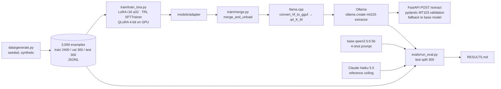

# mt103-extractor-lora

A LoRA fine-tuned small language model that turns messy payment text (emails, chat messages, half-pasted
SWIFT blocks, tickets) into **validated MT103 JSON**. It is evaluated against its own base model and a
Claude Haiku reference, and served locally through Ollama (GGUF q4_K_M) behind a FastAPI `/extract` endpoint.
No cloud and no GPU are needed to run it.

> **All data in this repo is SYNTHETIC.** It comes from a seeded generator (`data/generate.py`, seed 103), and every
> record carries `"synthetic": true`. Bank BICs and the reference pattern come from the author's
> [swift-mt103-monitor](https://github.com/malhar-sk/swift-mt103-monitor) simulator. No real payments are used.

> **Training status:** the build machine has no GPU, so the fine-tuned model here is a **CPU smoke run
> (150 steps, about 0.125 epoch, Qwen2.5-0.5B), not fully trained**. The full QLoRA run (Qwen2.5-1.5B, 3
> epochs) is ready in `notebooks/kaggle_train.ipynb` for Kaggle's free T4.

## Architecture



## What's in it

| Path | What |
|---|---|
| `schema.py` | pydantic model of the MT103 fields used: `:20:` sender ref, `:23B:`, `:32A:` (value date, ISO-4217 currency, positive amount), `:50K:`, `:52A:`, `:57A:`, `:59:`, `:70:`, `:71A:` (OUR/SHA/BEN). It validates the BIC format, the date and the currency, plus an `errors` list with machine codes (`INVALID_CURRENCY`, `INVALID_DATE`, `INVALID_BIC`, `NON_POSITIVE_AMOUNT`, `INVALID_CHARGES`, `MISSING_REQUIRED`) |
| `data/generate.py` | Seeded generator. Five surface styles (email, chat, raw SWIFT block, ops ticket, forwarded mail), typos, Indian number formats (`1,25,000.50`), "2.5 lakh", mixed date formats, optional fields dropped, and impossible values (month 13, `USX`, bad BICs, negative amounts) that must be **flagged in `errors`, not invented**. 657 of 3,000 examples carry errors |
| `prompts.py` | The long 4-shot prompt for base models and the short prompt the LoRA model is trained with |
| `evals/run_eval.py` | One eval script for every variant: valid-JSON rate, schema-valid rate, per-field and macro exact match, all-fields-correct, error-flag precision/recall, latency, tokens/sec. Disk cache, resumable |
| `train/train_lora.py`, `train/config.yaml` | LoRA training with TRL `SFTTrainer`, loss on the completion only, val loss and val generation metrics, loss plot. Auto-selects full QLoRA (GPU) or smoke (CPU) |
| `notebooks/kaggle_train.ipynb` | Self-contained Kaggle notebook: installs, regenerates and hash-checks the dataset, runs QLoRA on 1.5B, zips the adapter |
| `train/merge.py`, `serve/Modelfile.tmpl`, `Makefile` (`merge`, `gguf`) | Merge, then llama.cpp GGUF q4_K_M, then `ollama create` |
| `serve/app.py` | FastAPI `POST /extract {text}` returns validated fields, `errors`, `validation_errors`, latency and tokens/sec. Falls back to the base model (with the few-shot prompt) if the fine-tuned one isn't in Ollama, and says so (`fallback: true`, `note`) |

## Stack

Python 3.11 · Hugging Face `transformers`, `peft`, `trl` (SFTTrainer), `datasets` · `bitsandbytes` (GPU only) ·
Qwen2.5-0.5B-Instruct (CPU) / Qwen2.5-1.5B-Instruct (GPU) · pydantic · llama.cpp (GGUF q4_K_M) · Ollama in Docker ·
FastAPI · pytest · Docker Compose.

## Quick start

```bash
docker compose up -d --build && docker compose exec ollama ollama pull qwen2.5:0.5b-instruct
make test          # LLM mocked
make eval-base     # baseline table (served from the committed cache)
make serve         # POST http://127.0.0.1:18000/extract
```
TESTING.md has the full step-by-step walkthrough, including Kaggle training and `make merge serve eval-ft`.

## Results

Full table, commands and dataset sizes are in **[RESULTS.md](RESULTS.md)**. Test split, 300 synthetic examples:

| Model | n | Valid JSON | Schema-valid | Field acc (macro) | All fields right | Err precision | Err recall | Latency p50 (s) | Tokens/s |
|---|---|---|---|---|---|---|---|---|---|
| Base Qwen2.5-0.5B-Instruct (Ollama q4_K_M, 4-shot prompt) | 300 | 100.0% | 59.0% | 62.6% | 1.0% | 0.0% | 0.0% | 13.0 | 13.5 |
| Fine-tuned Qwen2.5-0.5B LoRA (GGUF q4_K_M, short prompt). **CPU smoke run, not fully trained** | 300 | 100.0% | 83.3% | 94.2% | 51.7% | 5.3% | 7.2% | 9.3 | 22.4 |
| Claude Haiku 5.5 via API (4-shot prompt), reference ceiling | 300 | 100.0% | 97.0% | 99.1% | 91.3% | 98.5% | 97.1% | 5.6 | 213.9 |

Headline: field accuracy **62.6% → 94.2%** (base → smoke-fine-tuned), valid JSON **100%**, **22.4 tok/s** on 1 CPU thread. Error flagging is still weak after the smoke run (recall 7.2%). See RESULTS.md.

## Limitations

- **Synthetic data.** Real MT103s and real ops emails are far more varied: other languages, scanned PDFs,
  multi-payment emails, field 33B/36/56A/72, structured 59F addresses, IBAN checksums. These numbers say how well
  a model learns *this generator's* distribution, not production accuracy.
- **The fine-tuned model is a CPU smoke run** (300 training examples seen, 0.125 epoch). A full GPU run should do
  better, especially on error flagging, which the smoke model mostly hasn't learnt yet.
- The test split shares templates and vocabulary with training, so it measures in-distribution generalisation.
- Exact-match scoring is strict: a correct but differently-written address counts as wrong.
- Latency and tokens/sec were measured on a shared 2 vCPU VPS with Ollama capped at 1 CPU, while other services were running.

## What I'd do next

- Run the full QLoRA on Kaggle (1.5B, 3 epochs) and add that row; compare 0.5B vs 1.5B for size versus accuracy.
- **Constrained JSON decoding** (Ollama `format` with the JSON schema, or llama.cpp GBNF grammar) so that schema-valid output is guaranteed by construction.
- Run it on a **Raspberry Pi 5** (q4_K_M 0.5B is about 400 MB) and report tokens/sec there.
- More fields (33B, 36, 56A, 72, 59F structured addresses), IBAN/BIC directory checks, multi-payment inputs.
- Harder, adversarial test data written by hand (and a small real, anonymised set if one can be obtained).

## Resume line

"Fine-tuned Qwen2.5 with LoRA for MT103 payment extraction: field accuracy 62.6% → 94.2% vs base (CPU smoke
run), 100% valid JSON; served locally via Ollama (GGUF q4_K_M) at 22 tok/s on a 1-vCPU budget."

## Licence

MIT (see `LICENSE`). Qwen2.5 weights are under the Apache-2.0 licence and are not included in this repo. llama.cpp (MIT) is cloned at build time into `third_party/`.
