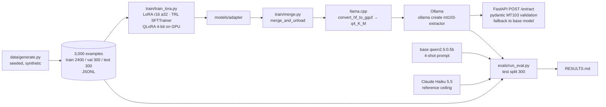

# mt103-extractor-lora

A LoRA fine-tuned small language model that turns messy payment text (emails, chat messages, half-pasted
SWIFT blocks, tickets) into **validated MT103 JSON**. It is evaluated against its own base model and a
Claude Haiku reference, and served locally through Ollama (GGUF q4_K_M) behind a FastAPI `/extract` endpoint.
No cloud and no GPU are needed to run it.

> **All data in this repo is SYNTHETIC.** It comes from a seeded generator (`data/generate.py`, seed 103), and every
> record carries `"synthetic": true`. Bank BICs and the reference pattern come from the author's
> [swift-mt103-monitor](https://github.com/malhar-sk/swift-mt103-monitor) simulator. No real payments are used.

> **Training status:** the adapter in `models/adapter/` is the **full run on the format-diverse v2 data**
> (Qwen2.5-0.5B, LoRA fp16, 2 epochs, 4,800 examples, 39 min on a Kaggle T4; `bash kaggle/push.sh`, see
> [docs/kaggle.md](docs/kaggle.md)). Its numbers are in **Eval round 4** below and were measured on the GPU with
> the fp16 adapter, and again on the CPU build the API serves (GGUF q4_K_M via Ollama): 99.1% on the test split,
> 89.0% on OOD, with rules.
> Rounds 1–3 describe the earlier CPU smoke run (150 steps, v1 data), which is kept in git history.

## Architecture



## What's in it

| Path | What |
|---|---|
| `schema.py` | pydantic model of the MT103 fields used: `:20:` sender ref, `:23B:`, `:32A:` (value date, ISO-4217 currency, positive amount), `:50K:`, `:52A:`, `:57A:`, `:59:`, `:70:`, `:71A:` (OUR/SHA/BEN). It validates the BIC format, the date and the currency, plus an `errors` list with machine codes (`INVALID_CURRENCY`, `INVALID_DATE`, `INVALID_BIC`, `NON_POSITIVE_AMOUNT`, `INVALID_CHARGES`, `MISSING_REQUIRED`) |
| `data/generate.py` | Seeded generator. Five surface styles (email, chat, raw SWIFT block, ops ticket, forwarded mail), typos, Indian number formats (`1,25,000.50`), "2.5 lakh", mixed date formats, optional fields dropped, and impossible values (month 13, `USX`, bad BICs, negative amounts) that must be **flagged in `errors`, not invented**. 657 of 3,000 examples carry errors |
| `data/generate_v2.py` | Format-diverse training data v2 (6,000): 10 new renderer families (chat logs, SWIFT with distractor tags, forms, CSV, YAML-like, letters, multilingual labels, forwarded threads), label synonyms, random field order, distractor amounts/refs/dates, lakh/crore, typo noise. Strictly held out from the OOD set (`tests/test_v2_heldout.py`) |
| `data/generate_ood.py` | The out-of-distribution test set (100), unchanged since eval round 2 |
| `postprocess.py` | Deterministic rules on top of any model: normalise (symbols, lakh, dates), validate (ISO-4217, BIC shape, real date, amount > 0), drop values that are not in the source text, fix contradictory error flags. Tested to leave every gold answer unchanged |
| `prompts.py` | The long 4-shot prompt for base models and the short prompt the LoRA model is trained with |
| `evals/run_eval.py` | One eval script for every variant: valid-JSON rate, schema-valid rate, per-field and macro exact match, all-fields-correct, error-flag precision/recall, latency, tokens/sec. Disk cache, resumable |
| `train/train_lora.py`, `train/config.yaml` | LoRA training with TRL `SFTTrainer`, loss on the completion only, val loss and val generation metrics, loss plot. Auto-selects full QLoRA (GPU) or smoke (CPU) |
| `kaggle/` (`push.sh`, `kernel-metadata.json`, `kaggle_train.ipynb`) | Kaggle kernel, one command: regenerates and hash-checks the data, trains the LoRA on v2, scores it on the v1 test, v2 test and OOD sets (raw and + rules), saves adapter + metrics. Built from the repo by `notebooks/build_notebook.py` |
| `train/merge.py`, `serve/Modelfile.tmpl`, `Makefile` (`merge`, `gguf`) | Merge, then llama.cpp GGUF q4_K_M, then `ollama create` |
| `serve/app.py` | FastAPI `POST /extract {text}` returns validated fields, `errors`, `validation_errors`, latency and tokens/sec. Applies `postprocess.py` by default (`POSTPROCESS=0` turns it off) and also returns the raw `model_output`. Falls back to the base model (with the few-shot prompt) if the fine-tuned one isn't in Ollama, and says so (`fallback: true`, `note`) |

## Stack

Python 3.11 · Hugging Face `transformers`, `peft`, `trl` (SFTTrainer), `datasets` · `bitsandbytes` (GPU only) ·
Qwen2.5-0.5B-Instruct (CPU) / Qwen2.5-1.5B-Instruct (GPU) · pydantic · llama.cpp (GGUF q4_K_M) · Ollama in Docker ·
FastAPI · pytest · Docker Compose.

## Quick start

```bash
docker compose up -d --build && docker compose exec ollama ollama pull qwen2.5:0.5b-instruct
make test          # LLM mocked
make eval-base     # baseline table (served from the committed cache)
make serve         # POST http://127.0.0.1:18000/extract
```
TESTING.md has the full step-by-step walkthrough, including Kaggle training and `make merge serve eval-ft`.

## Container runtime

Runs with **Docker** (Docker Desktop on Windows/macOS, Docker Engine on Linux) using `docker compose up -d`.
The Compose file sticks to the standard Compose spec, so other Compose-compatible tools (Podman, OrbStack,
Rancher Desktop, Colima) can run it too. Tested with rootless Podman 4.9.3 + podman-compose 1.3.0, CPU only (see `.github/workflows/podman.yml`).
Why Docker and not the others: [docs/adr/0001-container-runtime.md](docs/adr/0001-container-runtime.md).

## Results

Full table, commands and dataset sizes are in **[RESULTS.md](RESULTS.md)**. Test split, 300 synthetic examples:

| Model | n | Valid JSON | Schema-valid | Field acc (macro) | All fields right | Err precision | Err recall | Latency p50 (s) | Tokens/s |
|---|---|---|---|---|---|---|---|---|---|
| Base Qwen2.5-0.5B-Instruct (Ollama q4_K_M, 4-shot prompt) | 300 | 100.0% | 59.0% | 62.6% | 1.0% | 0.0% | 0.0% | 13.0 | 13.5 |
| Fine-tuned Qwen2.5-0.5B LoRA (GGUF q4_K_M, short prompt). **CPU smoke run, not fully trained** | 300 | 100.0% | 83.3% | 94.2% | 51.7% | 5.3% | 7.2% | 9.3 | 22.4 |
| Claude Haiku 5.5 via API (4-shot prompt), reference ceiling | 300 | 100.0% | 97.0% | 99.1% | 91.3% | 98.5% | 97.1% | 5.6 | 213.9 |

Headline: field accuracy **62.6% → 94.2%** (base → smoke-fine-tuned), valid JSON **100%**, **22.4 tok/s** on 1 CPU thread. Error flagging is still weak after the smoke run (recall 7.2%). See RESULTS.md.

**Eval round 2** ([RESULTS.md § Eval round 2](RESULTS.md#eval-round-2-added-2026-11-23)):

- **Out-of-distribution set** (100 synthetic examples, new seed, 4 unseen formats, OCR-style label noise,
  distractor remarks, new date formats and new impossible values): the fine-tuned model drops **94.2% → 66.7%**.
  The base model drops 62.6% → 47.5% and Claude Haiku 99.1% → 98.1%. Fine-tuning still adds +19 pp over the base
  model, but most of the in-distribution score is memorised format. On MT103 text with **shuffled, lower-case tags**
  the fine-tuned model reaches only 44.9%, which suggests it maps fields by position, not by tag.
- **Fields that still fail** (test split): 57A (80.3%), 52A (87.7%), 23B (89.7%): dropped, or 52A/57A swapped.
  Then amount, charges and value_date (90–91%). The top error type is "value present but returned null" (38% of errors).
- **Why error recall is 7.2%:** the smoke model learnt the *format* of error strings but not *when* to emit them.
  It flags valid values (`SHA is not OUR/SHA/BEN`, a 31% false-alarm rate on clean examples) and silently "repairs"
  32% of real errors (`2027-00-12` → `2027-01-12`, `USX` → `USD`). MISSING_REQUIRED is never flagged. The full Kaggle
  run must fix these, with oversampled error examples; RESULTS.md has the breakdown by error code.

**Eval round 3** ([RESULTS.md § Eval round 3](RESULTS.md#eval-round-3-added-2026-11-24-ood-diagnosis-format-diverse-data-post-processing)). No model was retrained in
this round; every number here is measured on the smoke model's existing outputs. The retrained model is round 4.

- **OOD diagnosis:** the worst OOD fields are 52A (39%), 57A (46%), ordering account (59%), sender reference (61%),
  charges (62%) and value date (64%). The smoke model picks the BIC slot, the party and the reference by *position*
  in the v1 templates, not by label.
- **Deterministic rules** (`postprocess.py`, measured on the cached outputs, 0 field values made worse):

  | | Test split | + rules | OOD | + rules |
  |---|---|---|---|---|
  | Fine-tuned 0.5B (CPU smoke): field acc | 94.2% | **95.7%** | 66.7% | **69.5%** |
  | Fine-tuned 0.5B (CPU smoke): error recall | 7.2% | **53.6%** | 2.3% | **48.8%** |
  | Base 0.5B, 4-shot: field acc | 62.6% | **69.4%** | 47.5% | **53.8%** |

  The rules fix dates, charges, currencies and contradictory error flags; they cannot fix the positional
  confusions (52A stays at 39% on OOD). That needs retraining.
- **Training data v2** (`data/generate_v2.py`, 6,000 examples, 10 new formats), strictly held out from the OOD set
  (tested). On its v2 test split the current v1-trained smoke model scores 80.4% (150 examples, measured), so v2 is clearly harder than v1's 94.2%.
- **Retraining on v2:** done, see round 4.

**Eval round 4: full training on v2** ([RESULTS.md § 5](RESULTS.md#5-retrained-on-v2-measured-2026-11-24-kaggle-t4)).
Kaggle T4, fp16 LoRA adapter, same short prompt. "+ rules" is the same raw output through `postprocess.py`.

| Field accuracy (macro) | Smoke run (v1) | **Full run (v2)** | Full run + rules | Claude Haiku 5.5 + rules |
|---|---|---|---|---|
| Test split (n=300) | 94.2% | **99.3%** | **99.4%** | 99.1% |
| v2 test split (n=600; smoke: first 150) | 80.4% | **98.8%** | **99.0%** | not measured |
| OOD set (n=100) | 66.7% | **89.1%** | **90.3%** | 98.3% |
| OOD: 52A ordering institution | 39% | 62% | 70% | 96% |
| OOD: 57A account-with institution | 46% | 74% | 78% | 95% |
| OOD: error precision / recall | 2.2% / 2.3% | 43.4% / 53.5% | 78.6% / 76.7% | 92.9% / 90.7% |

The API serves the same adapter merged and quantised to **GGUF q4_K_M (398 MB) on CPU** via Ollama. Measured there
(1 CPU, same prompt): field accuracy **98.9% / 99.1% with rules** on the test split and **87.0% / 89.0%** on OOD,
so quantisation costs about 0.3 points in distribution and 1–2 points on OOD. 52A on OOD: 58% raw, 68% with rules.
Latency p50 8.4 s and about 25 tokens/s on the shared VPS (the smoke model: 9.3 s, 22 tokens/s).

- **The OOD gap is mostly closed, not gone.** OOD accuracy rose 23 points, and the `swift_shuffled` format (shuffled,
  lower-case tags) went from about 44% to 92%, so the model now reads tags instead of positions. But only 34% of OOD
  messages have every field right (Haiku: 80%), and 52A at 70% is still the weakest field.
- **In distribution it matches Haiku** (99.4% vs 99.1% on the test split) at 0.5B parameters, on synthetic data.
- **Error flagging works now:** error recall on the test split went from 7.2% to 88.4% raw and 95.7% with rules.

## Limitations

- **Synthetic data.** Real MT103s and real ops emails are far more varied: other languages, scanned PDFs,
  multi-payment emails, field 33B/36/56A/72, structured 59F addresses, IBAN checksums. These numbers say how well
  a model learns *this generator's* distribution, not production accuracy.
- **Quantisation costs a little.** The served CPU build (GGUF q4_K_M) scores 89.0% on OOD with rules, against 90.3%
  for the fp16 adapter on a GPU. CPU latency (8.4 s p50) was measured on a shared 2 vCPU VPS with Ollama capped at 1 CPU.
- The test split shares templates and vocabulary with training, so it measures in-distribution generalisation. The OOD set (`data/ood_test.jsonl`) is a first check outside that, but it is still synthetic and small (n=100; 3–12 examples per error code).
- Exact-match scoring is strict: a correct but differently-written address counts as wrong.
- Latency and tokens/sec were measured on a shared 2 vCPU VPS with Ollama capped at 1 CPU, while other services were running.

## What I'd do next

- ~~Run the Kaggle kernel~~ and ~~re-measure the CPU build~~ done in round 4. Next: try 1.5B for size versus accuracy, mainly to lift 52A/57A on OOD.
- ~~Make training data format-diverse~~ done in round 3 (`data/generate_v2.py`), deliberately **without** the OOD set's own tricks (tag shuffling, pipe tables, OCR swaps), so the OOD score stays an honest test.
- ~~Rule-based post-check~~ done in round 3 (`postprocess.py`).
- **Constrained JSON decoding** (Ollama `format` with the JSON schema, or llama.cpp GBNF grammar) so that schema-valid output is guaranteed by construction.
- Run it on a **Raspberry Pi 5** (q4_K_M 0.5B is about 400 MB) and report tokens/sec there.
- More fields (33B, 36, 56A, 72, 59F structured addresses), IBAN/BIC directory checks, multi-payment inputs.
- Harder, adversarial test data written by hand (and a small real, anonymised set if one can be obtained).

## Resume line

"Fine-tuned Qwen2.5 with LoRA for MT103 payment extraction: field accuracy 62.6% → 94.2% vs base (CPU smoke
run), 100% valid JSON; served locally via Ollama (GGUF q4_K_M) at 22 tok/s on a 1-vCPU budget."

## Licence

MIT (see `LICENSE`). Qwen2.5 weights are under the Apache-2.0 licence and are not included in this repo. llama.cpp (MIT) is cloned at build time into `third_party/`.
